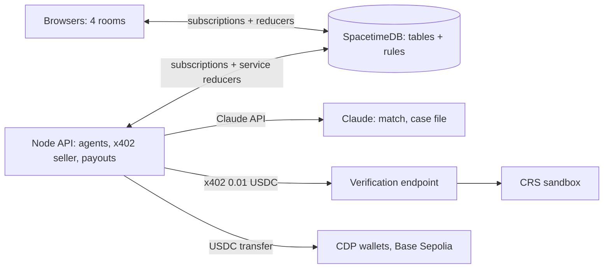

# GovFlow AI: hack plan

**Deadline:** Sat Oct 24, evening (assumed 18:00 PDT). **Tracks:** CRS, Coinbase (x402 + CDP), SpacetimeDB, Anthropic.
Full product spec: `PROJECT.md`.

## MVP journey

An impostor emails the agency "we changed our wallet", and the prime's pay application freezes. In parallel, a clean
pay application runs: accepted work → Claude matches it → the agent pays 0.01 test USDC over x402 for a CRS check
→ two human approvals → USDC settles on Base Sepolia. Then the same flow runs one level down, prime → sub.

## Cut list (roadmap, not today)

- Evidence summarizer agent and Claude vision checks of evidence photos / documents (incl. PII checklist)
- Invoice drafter agent
- Full 10-invoice answer key UI run (use 2–3 planted bills)
- Prompt-injection and spend-cap test suites (`tests/*.ts` are stubs)
- Payout reconciliation report (`api/src/payout/reconcile.ts`)
- OTP / step-up flows, bank on/off ramp

## Stack

| Pick | Role | Status |
|---|---|---|
| SpacetimeDB (Maincloud `govflow-855y2`) | live rooms, rules in reducers, ledger, audit | built, 73 tests |
| Next.js + shadcn/ui | agency / prime / sub / inspector rooms | built, live data |
| Anthropic TS SDK, `claude-opus-5-5` | invoice matcher, fraud case files | built, live |
| Coinbase CDP + x402 | 0.01 paid CRS checks, USDC payouts (Base Sepolia only) | built, live |
| CRS sandbox | TransUnion ID check, Fraud Finder, credit file, liens/judgments | built, live |

**Riskiest part (spiked 11:30):** whether Claude's match is consistent. 3/3 stable on clean, wrong-work and
prompt-injection bills. A rule check in code backs it, and a rule failure always wins.

## Architecture

The API connects once as the service identity. It sweeps the cache every 5 s (and on every row change), does the
outside work, and writes results through service-only reducers. The database re-checks every rule.

## Honesty (disclose in the demo)

- CRS test personas only; the identity data is fake.
- **Business verification is a mock**: officer match, entity age and filing changes run on mock registry records
  (`state_filing:mock`). CRS has no business-registry product.
- Fraud Finder falls back to a labelled mock (`fraud_finder:mock`) if the sandbox call fails.
- Test USDC on Base Sepolia, pre-funded treasuries from the faucet, no bank on-ramp, tiny amounts (≤ 1.00 USDC cap).
- The x402 verification endpoint runs on localhost.
- The payout adapter defaults to simulated; `PAYOUT_ADAPTER=cdp` sends real testnet transfers.
- The fraud email is seeded. The claimed sender is identified by name in the email text, not by real email authentication.
- The agency's own registry check is a seeded PASS.

## Judge questions the team must answer

1. What stops the agent from paying an impostor? (Reducers, two human approvals, wallet must equal the verified payout wallet, freeze on any change.)
2. What does the 0.01 x402 payment buy, and what doesn't it prove? (A paid CRS check; not legal identity or signing authority.)
3. What if the API crashes mid-payout? (Idempotency key per payout + CDP idempotency; payments resume from their recorded state.)

## Pitch

**One-liner:** GovFlow lets a city pay its contractors in USDC only after CRS verifies who is being paid, Claude checks the bill against accepted work, and two verified people approve.
**Roles:** Driver _TBD_ · Narrator _TBD_ · Tech answers _TBD_ · Backup _TBD_. Script, 30-second version and Q&A: `PITCH.md`.

## Status log

- 10:35 Sat · Harden · weakest: Functionality (no Claude, manual match) · next: spike + build the matcher
- 12:42 Sat · Freeze · weakest: Functionality (demo not rehearsed in the UI; live data used up) · next: commit + push, reseed, rehearse in the UI, README
- 12:55 Sat · Freeze · reseeded Maincloud (0.40 / 0.60 / 0.15 milestones, Fraud Finder on every org, roles re-approved) · next: rehearse once in the UI, commit + push, README
- 22:49 Sat · Ship · secret scan clean (files + history), fresh clone typechecks, README has value prop/architecture/setup/honesty; DEVPOST.md drafted · missing: backup video, pitch roles, Team/Built-at in README, live URL, ~22 uncommitted files · next: record video, /hack-pitch, commit + push
