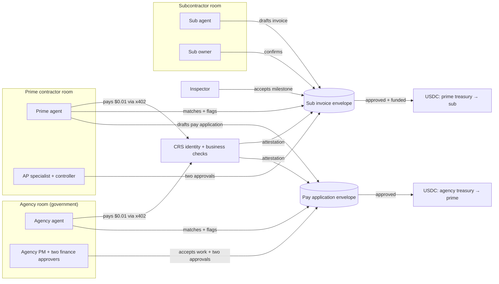
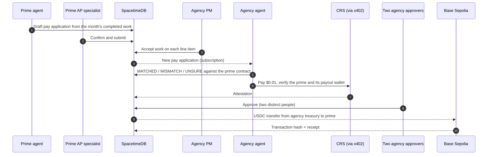
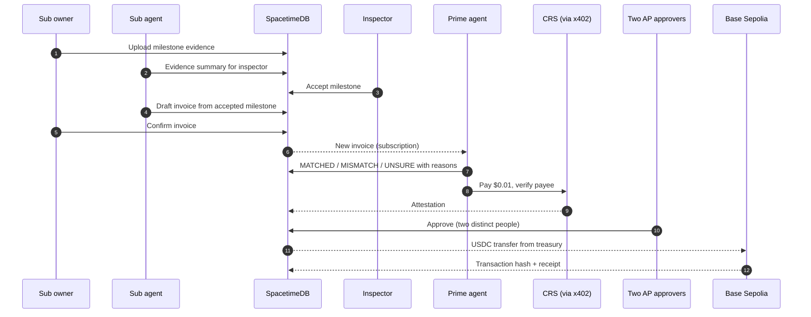
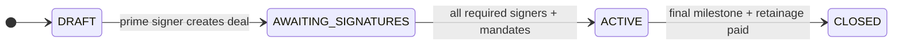
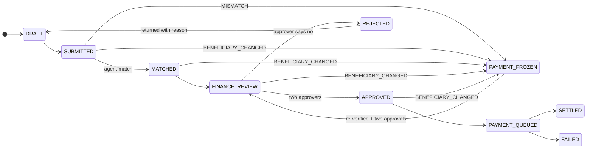
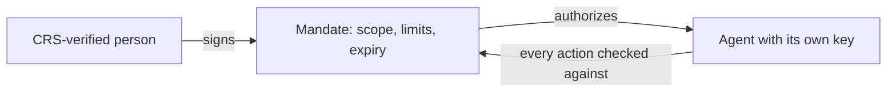
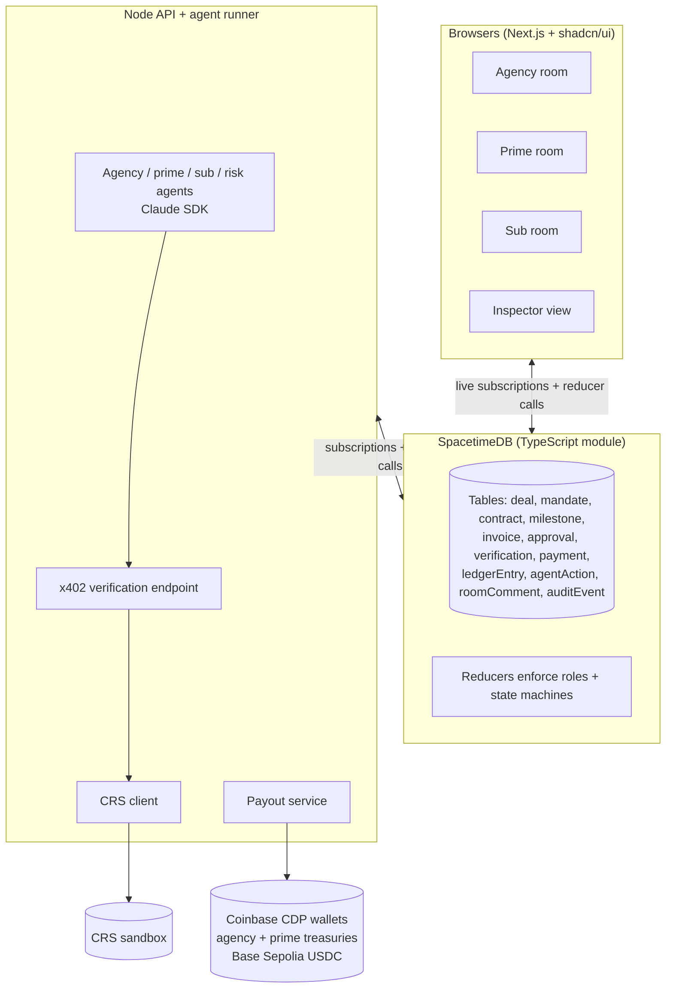

# GovFlow AI

> Verified, multiplayer payment workflow for public construction projects.
> Agents do the paperwork from the government agency, through the prime contractor,
> down to a paid subcontractor; verified humans keep authority over every decision
> that moves money.

**Who's who.** The **agency** is the government body that owns the project, funds it
and awards the contract (a city public works department, a county transportation
commission, a state DOT). The **prime contractor** wins that contract and is
responsible for the whole job. **Subcontractors** are specialist firms the prime hires
for parts of it. Contracts and money both flow down the chain:

```
Agency (government) ──prime contract──▶ Prime contractor ──subcontract──▶ Subcontractor
```

Cal Hacks 13.0 · October 23–25, 2026 · Prototype

---

## 1. Problem

Public agencies and construction contractors move large progress payments through
email threads, PDFs and approvals spread across separate systems. That gap is where
money gets stolen and where honest subcontractors wait.

**Impersonation and payment redirection.** A fraudster hijacks or spoofs a contractor's
email and sends "we changed banks." The next payment goes to the fraudster.

| Agency | What happened |
|---|---|
| Alameda County Transportation Commission (reported Oct 2026) | Scammer replied inside a real email thread and redirected a $500,000 payment |
| El Paso streetcar project | $2.9M paid to thieves posing as the city's vendors |
| Washoe County Regional Transportation Commission | $1.4M lost to an email posing as a vendor |
| Saskatoon bridge rehabilitation | Fraudster posed as a contractor's CFO and diverted a $1.04M progress payment |
| Baltimore Public Works | $1.5M sent to a fake vendor account; $803K never recovered |

**Fragmented approvals and forged documents.** Approvals are collected one at a time
over email, signatures aren't tied to verified people, and the system that approves a
payment is not the system that sends it.

**Slow payment down the chain.** Subcontractors wait a median of about 50 days to be
paid, and 92% floated payroll in 2025 while waiting.

**What faster payment alone does not fix:** fraudulent authorization and upstream
funding delays. Speed only helps once a payment is known to be legitimate and funded.

## 2. Users

| Persona | Needs | Can do in the MVP |
|---|---|---|
| Agency project manager / resident engineer | Pay only for work actually done on the prime contract | Accept or reject the prime's pay application line items |
| Agency finance approvers (two) | Never pay an impostor; pay legitimate primes on time | Approve, reject, unfreeze pay applications |
| Prime contractor AP specialist | Bill the agency and process sub invoices without chasing paperwork | Work with the prime's agent; prepare pay applications and payment packets |
| Prime contractor AP controller | Approve only legitimate sub payments; catch redirects | Approve, reject, unfreeze (with a second approver) |
| Subcontractor owner | Get paid quickly for accepted work | Submit evidence and invoices; manage own verified wallet |
| Inspector (prime side) | Confirm sub work was actually done | Accept or reject milestone evidence |

**Primary buyer hypothesis:** public-works agencies (the payers in every fraud case
above) and the prime contractors they fund. Not yet validated.

## 3. Goals and non-goals

**Goals**

1. Only authorized, identity-verified people can start a deal or approve money.
2. A beneficiary change can never take effect from an email, call or video alone.
3. Agents handle routine preparation so clean invoices move without human chasing.
4. Every decision traces back to the data, rule or person behind it.
5. Approved, funded payments settle in seconds at both levels: agency → prime and prime → sub.

**Non-goals (MVP)**

- Bidding, RFP extraction and contract award (roadmap)
- Real money or mainnet transactions
- Bank on/off ramps for agencies (we assume the agency treasury already holds test USDC)
- International identity verification
- AI making approval, inspection or payment decisions

## 4. Solution

A permissioned, multi-organization workspace:

- Each organization has a **private room** where its people and its own AI agent prepare work together, live.
- Organizations share only a narrowly scoped **payment envelope** for each invoice.
- **CRS** verifies every person, business and payout owner.
- **Claude** agents summarize, match and flag; they never decide.
- **Two accountable humans** approve each payment; requester and approver are always different people.
- Approved, funded payments settle in **test USDC** on Base Sepolia at both levels, with a receipt in the audit log.
- The same rules run at both levels: whoever is paying is the one that matches, verifies and approves.



## 5. How a deal runs

A project has two linked deals that use the same rules: the **prime contract**
(agency pays prime) and one or more **subcontracts** (prime pays sub). Every contract,
invoice and payment records who pays (`payerOrgId`) and who is paid (`payeeOrgId`).

### Starting a deal (humans only)

1. The agency's verified signer creates the prime deal from the signed prime contract and invites the prime.
2. The prime's verified signer creates each subcontract deal, linked to the prime contract, and invites the sub.
3. Each organization's CRS-verified signer signs its deal.
4. Each signer also signs a **mandate** for their organization's agent: scope, limits, expiry.
5. A deal goes ACTIVE only when every required signature is in.

### Running the prime contract: agency → prime (monthly pay application)



The prime contract's schedule of values caps what the prime can bill; the agency
agent flags any line billed past it.

### Running a subcontract: prime → sub (agents, humans on exceptions)



### The fraud moment

The demo's headline case is the Alameda pattern at the government level: an email
that looks like it comes from the prime reaches the agency: "We changed our wallet,
pay this one instead." The pay application freezes at once. The agency's risk agent
writes a case file. Payment resumes only after the prime's real owner re-verifies
through CRS, signs from the new wallet, and two agency approvers confirm. An impostor
fails the CRS check, so the money never moves. The same freeze protects the
prime → sub level.

## 6. State machines





- **Invoice** covers both a sub's invoice to the prime and the prime's pay application to the agency (`kind`: SUB_INVOICE or PAY_APPLICATION). The approvers are always from the paying organization.
- **Milestone:** NOT_STARTED → IN_PROGRESS → SUBMITTED_FOR_INSPECTION → ACCEPTED / REJECTED. Only the paying side accepts: the prime's inspector for sub work, the agency PM for the prime's pay-application lines.
- **Payment:** CREATED → POLICY_CHECKED → AUTHORIZED → SUBMITTED → CONFIRMED / FAILED. One idempotency key per payment; a hold blocks SUBMITTED.

## 7. Trust model

| Who | How they're trusted |
|---|---|
| People | CRS identity verification once at onboarding; step-up re-verification for wallet changes, unfreezing, large approvals and new signers |
| Businesses | CRS business credit and state filings, OFAC sanctions screening, liens and judgments |
| Wallets | Owner signs a challenge message; the wallet is bound to the verified owner |
| Agents | Not verified by CRS. Each has its own key and acts only under a mandate signed by a verified person |



**Segregation of duties:** whoever requests a payment can't approve it. Agents never approve.

## 8. Architecture



- **SpacetimeDB** is the shared source of truth. Browsers and agents connect directly, subscribe to the rows they care about, and get every change pushed live. Reducers are the only way to write, so rules live in one place.
- **Agents communicate only through SpacetimeDB tables**, never directly, so every handoff is an auditable record.
- **Secrets** (CRS, CDP, Anthropic keys) live only in the Node API.

## 9. Sponsors and what each does

| Sponsor | Role | Steps |
|---|---|---|
| CRS | Verifies people and businesses | Onboarding, wallet change, pre-payout check |
| Coinbase (x402 + CDP) | Agent wallets, paid verification calls, USDC payouts at both levels | Pre-payout check, payout |
| SpacetimeDB | Live rooms, state machines, audit log, ledger | Every step |
| Anthropic Claude | Evidence summary, invoice matching, risk case files | Review steps |
| Hyphenate | Judging: autonomous accounts payable | Whole flow |
| Microsoft | Judging: production-minded agent | Whole flow |

## 10. Why stablecoins

Verification stops the fraud; stablecoins make the safe payment fast and programmable.
Both levels — agency → prime and prime → sub — settle in USDC, so public money moves
down the whole chain in one system. **Pitch angle: this is where public payments are
heading.** Programmable money lets a government pay only when the code sees verified
work and verified people, and lets that money reach the sub in seconds instead of
months.

1. **Approval and payment in one system.** Money moves only when the code sees every required signature.
2. **Agents can pay natively.** A $0.01 CRS check over x402 has no bank equivalent.
3. **Speed.** Seconds, any day, versus ACH business days and wire cutoffs.
4. **Audit trail.** Every payment has a permanent transaction hash tied to its approval chain.
5. **Reach.** Any verified wallet can be paid, including small subs and foreign suppliers.
6. **Money flows down the chain.** When the agency pays the prime, the prime's sub payments are funded in the same minute; nothing waits on bank settlement between levels.

Crypto payments can't be recalled, which makes verification before payment mandatory.
The approval layer is rail-agnostic: an agency that can't hold stablecoins yet can
keep paying by bank through an on/off ramp (roadmap) with the same verification rules.

## 11. Ledger

Double-entry entries in SpacetimeDB, kept per organization:

| Org | Event | Debit | Credit |
|---|---|---|---|
| Agency | Pay application approved | Construction costs | Accounts payable |
| Agency | Payout confirmed | Accounts payable | USDC treasury |
| Prime | Payment received from agency | USDC treasury | Accounts receivable |
| Prime | Sub invoice approved | Subcontract costs | Accounts payable |
| Prime | Sub payout confirmed | Accounts payable | USDC treasury |

Every USDC transfer onchain is reconciled against a ledger entry. An onchain transfer
with no approved entry is a red flag.

## 12. MVP scope

**Build**

- [ ] Seeded project: one agency, one prime, one sub, one inspector; prime contract and linked subcontract, each with a schedule of values
- [ ] Agency room: agency PM accepts pay-application lines; two agency finance approvers
- [ ] CRS verification for people and businesses; attestations only
- [ ] Deal signing and agent mandates
- [ ] Milestone evidence → inspector acceptance
- [ ] Prime pay application → agency agent match → two agency approvals
- [ ] Sub invoice → prime agent match → two prime approvals
- [ ] Beneficiary change freeze and re-verification
- [ ] x402 paid verification call with spend caps
- [ ] USDC payouts on Base Sepolia with receipts: agency treasury → prime, prime treasury → sub
- [ ] Ledger and audit log views
- [ ] Answer key: 10 seeded invoices with planted errors and expected decisions

## 13. Security controls

| Control | Behavior |
|---|---|
| Network | Base Sepolia only |
| Agent spend | Max 0.01 test USDC per call, 0.10 per session |
| Endpoints | Server allowlist; no AI-chosen URLs |
| Approvals | Two distinct authenticated humans from the paying organization; never the requester, never an agent |
| Wallet change | Freeze until CRS re-verification + two approvals |
| Idempotency | One key per verification charge and per payout |
| Prompt injection | Document text treated as data |
| PII | Attestations and hashes only; no raw identity data stored or logged |

## 14. Demo

| Time | Beat |
|---|---|
| 0:00–0:20 | Hook: Alameda lost $500K to one email. That email arrives at our agency, posing as the prime: "we changed our wallet." The pay application freezes |
| 0:20–0:50 | **Government → prime:** a clean pay application; agency PM accepts the work, the agency agent matches it and pays $0.01 for a CRS check, two agency approvers sign, USDC settles, tx hash in the ledger |
| 0:50–1:20 | **Prime → sub:** the same flow one level down, sped up; the sub is paid seconds after the prime, versus a ~50-day median |
| 1:20–2:00 | Back to the freeze: the real prime re-verifies through CRS; the impostor fails; the case file explains why |
| 2:00–2:30 | Why stablecoins: programmable public money is where government payments are heading |
| 2:30–3:00 | Answer-key results and roadmap |

The two payment flows (1:00 total) run live while the presenter talks over them. If
time is short, cut the prime → sub beat to a single shot of the sub's wallet balance
changing; it stays fully built.

**30-second version:** "Public agencies keep paying scammers who impersonate contractors.
Here, nobody can approve or get paid without a CRS-verified identity. Watch this wallet
change freeze while every legitimate payment settles instantly, from the government to
the prime contractor to the subcontractor."

## 15. Success measures

- Redirect attempts blocked: 100% of seeded attempts
- Answer key: correct decision on each of 10 planted-error invoices
- Time from accepted work to settled payout at both levels in the demo, versus a ~50-day median for subs
- Zero agent-initiated approvals, unfreezes or payouts (enforced and tested)

## 16. Real vs. simulated

| Real | Simulated |
|---|---|
| CRS sandbox calls | Test identities |
| x402 payments and USDC transfers on Base Sepolia | Test USDC, no real value |
| SpacetimeDB rules, ledger, audit log | Seeded contract, invoices and fraud email |
| Claude matching and case files | Agency treasury pre-funded with test USDC (no bank on-ramp) |

## 17. Risks and open questions

| Risk / question | Plan |
|---|---|
| Does CRS identity verification flag mismatches in the sandbox? | Spike first; otherwise compare prefill and identity fields ourselves |
| Do CRS one-time passcodes send in the sandbox? | Ask at the CRS booth |
| x402 or faucet issues on testnet | Simulated payout adapter as default; testnet behind a toggle |
| Which Coinbase track fits? | Ask at the Coinbase booth |
| Buyer not validated | Talk to anyone who handles contractor payments this weekend |
| Can a government agency actually hold and pay in stablecoins today? | Pitch it as the future; roadmap a bank on/off ramp so agencies can adopt the verification layer first |
| Public works use payment bonds, not lien waivers | Keep lien waivers as a private-lender extension only |

## 18. Roadmap

1. Bid and tender rooms with verified bidder profiles
2. Change orders and retainage release
3. Bank on/off ramps for agencies not yet holding stablecoins (Nessie as a prototype)
4. DBE front-company checks at bid time
5. International identity providers alongside CRS
6. Integration with construction accounting systems

## Sources

- [Alameda County Transportation Commission fraud, SF Standard](https://sfstandard.com/2026/10/08/alameda-county-transportation-commission-fraud-payments/)
- [El Paso streetcar scam, GovTech](https://www.govtech.com/security/Phishing-Scam-Prompts-Security-Changes-in-El-Paso-Texas.html)
- [Washoe County RTC, Las Vegas Sun](https://m.lasvegassun.com/news/2016/nov/03/washoe-county-transportation-commission-scammed-ou/)
- [Saskatoon bridge payment, CTV](https://saskatoon.ctvnews.ca/soon-saskatoon-to-provide-update-on-1-04m-fraud-investigation-at-11-a-m-1.4555719)
- [Baltimore, CBS News](https://www.cbsnews.com/amp/baltimore/news/maryland-city-fraud-theft-vendor-contractor-security-measures)
- [Subcontractor payment delays, Built](https://getbuilt.com/blog/subcontractor-payment-delays/)
- [92% of subcontractors floated payroll, GPA](https://gpa.net/blogs/top-posts/us-92-of-subcontractors-floated-payroll-in-2025)
- [CRS Financial Intelligence Challenge](https://calhacks.crscreditapi.com)
- [x402 documentation](https://docs.cdp.coinbase.com/x402/quickstart-for-buyers)
- [SpacetimeDB documentation](https://spacetimedb.com/docs/quickstarts/typescript)
