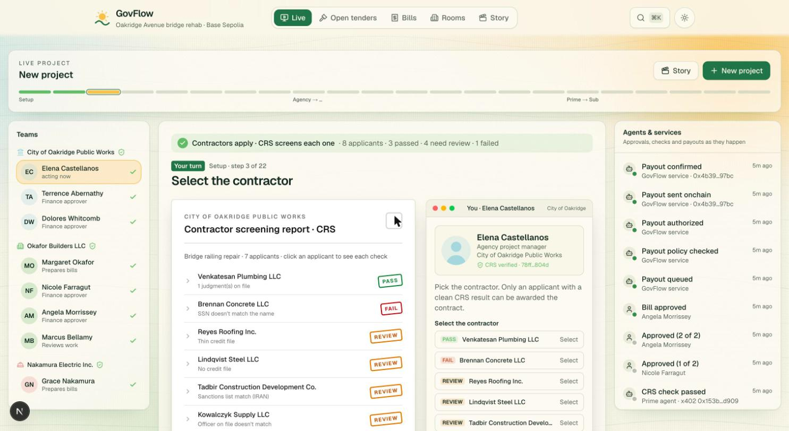
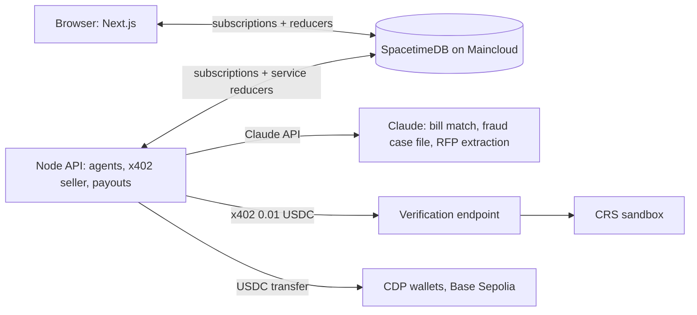

# GovFlow

GovFlow limits fraud on public contracts, making systems seamless and secure. CRS verifies every payee, Claude checks every bill, and USDC moves only after two verified people approve.

- Verified parties. Before a contract is awarded, GovFlow runs CRS sandbox checks on the business and the people behind it: TransUnion identity, credit file, PitchPoint liens and judgments, and Fraud Finder. An applicant who fails can't be selected. The database itself refuses the award. Only an attestation hash is stored, never the raw data.
- Claude reads the paperwork. Claude pulls company and owner details out of uploaded bid documents and matches them to CRS-verified companies. It then reads each pay application against the contract, the schedule of values and the accepted milestones, and returns MATCHED, MISMATCH or UNSURE with reasons.
- Agents pay for their own checks. Before any payout, the payer's agent buys a fresh CRS check on the payee for 0.01 test USDC over x402. The new result has to match the identity recorded at award.
- Fraud freeze. A "new wallet" email freezes the bill instantly. The agent re-verifies the payee, checks the claimed sender against CRS, and Claude writes a case file. Two approvers then reject the change.
- Two approvals, then settlement. USDC settles on Base Sepolia to the verified wallet. The same rules apply one level down, from prime to subcontractor.



| Pick | Role | Status |
|---|---|---|
| SpacetimeDB (Maincloud `govflow-855y2`) | live rooms, rules in reducers, ledger, audit | built, 73 tests |
| Next.js + shadcn/ui | agency / prime / sub / inspector rooms | built, live data |
| Anthropic TS SDK, `claude-opus-5-5` | invoice matcher, fraud case files | built, live |
| Coinbase CDP + x402 | 0.01 paid CRS checks, USDC payouts (Base Sepolia only) | built, live |
| CRS sandbox | TransUnion ID check, Fraud Finder, credit file, liens/judgments | built, live |


## The demo flow (`/live`)

The Live page tells the story from the city's point of view. The city's steps are buttons; everyone else's steps run by
themselves in pop-up windows, with a document for each stage (every one downloadable).

1. **Post the project.** Fill out the request for bids, or upload an RFP and Claude fills the form in
   (`web/public/samples/oakridge-rfp.pdf` is a ready-made one), then view the generated document. The city and
   everyone who will sign or approve are already CRS-verified. Posting saves the project to Open tenders.
2. **CRS screens every applicant:** identity, business credit, liens and judgments, sanctions, fraud signals, registry.
   Each applicant in the screening report opens to show every check, what it asked, its source and why it failed.
3. **Select the contractor.** Any applicant can be clicked; failed, flagged or record-carrying ones are refused with
   their reasons, and only the clean one can be selected.
4. **Okafor Builders' six pre-award checks** come back clean and are stored as an attestation hash, never raw data.
5. **The agents settle the offer:** the city's agent and Okafor's agent exchange the offer, schedule of values and
   insurance certificate (scripted messages, downloadable files).
6. **Issue, sign and countersign** the contract with the details from step 1; each side mandates its AI agent with a
   scope and budget.
7. **Proof of work → inspection → pay application.**
8. **Claude checks the bill** against the contract and accepted work (overbilling, unaccepted or double-billed work,
   prompt injection in the memo). It can flag, never approve or pay.
9. **Paid CRS check on the payee:** the agent pays 0.01 USDC over x402 for a fresh check, and its identity hash must
   match the one stored at award. A different person behind the business freezes the bill until two approvers accept
   the change with a reason. If a fresh paid check can't run (spend cap, CRS down, 25 s timeout), the agent reuses the
   payee's latest CRS result, clearly labelled, with no new charge.
10. **Optional fraud beat:** an impostor emails a new wallet (red flags called out on the email). Logging it freezes the
    bill, the agent re-verifies the payee and checks the sender, writes a case file, and both approvers reject the change.
11. **Both approvers sign off** in one window, then **USDC settles** on the payee's verified wallet. The receipt is
    verified: confirmed onchain, right amount, verified wallet, payer's treasury, both ledgers.
12. **The same rules one level down:** prime → subcontractor, with the sub's progress package (daily report, materials
    receipt, inspection) behind its invoice.
13. **Finale:** the bridge before and after, on time, in budget, no fraud.

## Pages

The top bar has five tabs; everything else (payment flow, envelope, ledger, audit, vendor checks) is in ⌘K.

| Tab | What it shows |
|---|---|
| Live | The run above. It remembers where you are, so you can switch tabs mid-demo and come back. |
| Open tenders | Every open tender and how long it has been open, downloadable bid packages, and each applicant's CRS result. Projects posted from Live appear here with their status. |
| Bills | Every bill's timeline, from submission to payout. |
| Rooms | One room per organization: City of Oakridge, Okafor Builders, Nakamura Electric. |
| Story | Slides: the problem (a real $2.5M contractor-impersonation loss), the solution, then the journey. Can also drive a live run. |

## Architecture



| Folder | What it is |
|---|---|
| `spacetimedb/` | TypeScript module: tables, per-org `my_*` views, reducers that enforce roles and state machines, tests |
| `api/` | Node service: Claude matcher and risk reviewer, x402-paid CRS checks, payout service. Holds every secret |
| `web/` | Next.js + shadcn/ui front end. Reads only through the database views, holds no secrets |
| `seed/` | Seeded deal, demo people, fraud email, 10-invoice answer key |
| `tests/` | Cross-cutting test stubs |

## Running it

Needs Node 22, the `spacetime` CLI, and `.env.local` at the repo root (copy `.env.example`; the setup guides
`CRS setup.md`, `Coinbase setup.md`, `Claude setup.md`, `SpacetimeDB setup.md` explain each key).

```bash
# API: agents, x402 seller and payouts
cd api && npm install && npm start

# Web: http://localhost:3100/live
cd web && npm install && npx next dev -p 3100
```

- **Payouts:** `PAYOUT_ADAPTER=cdp` sends real Base Sepolia transfers (a few seconds to confirm); `simulated` is instant.
- **Document upload:** the API serves `POST /api/extract` on port 4021 for the web app (`NEXT_PUBLIC_API_URL` to change it).
- **Demo logins:** `seed/.demo-tokens.json` and `seed/.demo-observer.json` (gitignored), served by the dev-only
  `/api/personas` route. The app opens as the read-only observer; Live acts for each person behind the scenes.
- **Reseeding:** `spacetime publish --delete-data` wipes the shared database, then `cd api && npm run seed`, then
  `cd web && npx tsx scripts/request-observer.ts` and approve it as owner
  (`spacetime call govflow-855y2 approve_observer_role <id>`). Restart the API and web server afterwards.
- **Module changes:** `spacetime publish --yes` from `spacetimedb/`, then regenerate bindings for web and api with
  `spacetime generate --lang typescript --out-dir web/lib/module_bindings --module-path spacetimedb`.

## Honesty

- CRS sandbox personas only
- Test USDC on Base Sepolia only, tiny amounts, capped at 1.00 USDC per payout.
- The fraud email is seeded; though each screening result is a real CRS sandbox check.
- Claude is live for bill matching, fraud case files and RFP extraction.
