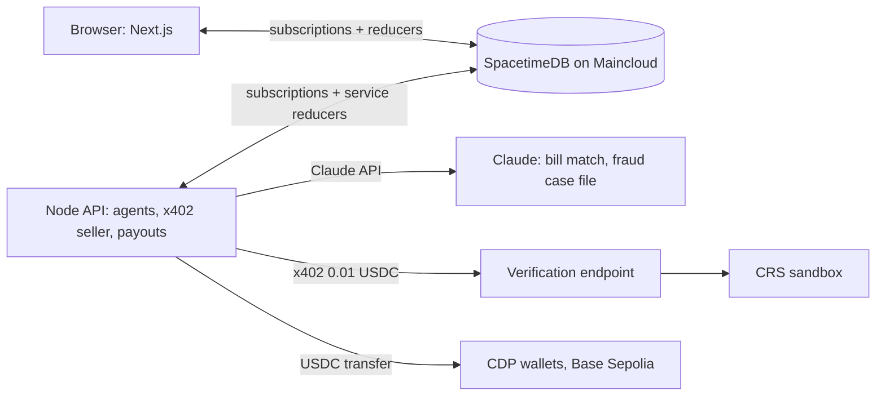

# GovFlow

Verified, multiplayer payments for public construction. A city pays its prime contractor, and the prime pays its
subcontractor, in test USDC on Base Sepolia. Before anyone is awarded a contract or paid, their identity is checked with
CRS. Claude agents check every bill, and two verified people approve every payment.

Hackathon build. Testnet only, CRS sandbox personas only. Full spec in `PROJECT.md`, hack plan and disclosures in `HACK.md`.

## The demo flow (`/live`)

The Live page tells the story from the city's point of view. The city's steps are buttons; everyone else's steps run by
themselves in pop-up windows, with a mock document for each stage.

1. **Post the project.** The city and everyone who will sign or approve are already CRS-verified.
2. **CRS screens every applicant.** Identity, credit, liens and judgments, sanctions, fraud signals, business registry.
3. **Select the contractor.** Two verified bids are compared side by side; trying an applicant that failed CRS is blocked,
   with the reasons shown.
4. **Okafor Builders' six pre-award checks** come back clean and are stored as an attestation hash, never raw data.
5. **The agents settle the offer:** the city's agent and Okafor's agent exchange the offer, schedule of values and
   insurance certificate (scripted messages, downloadable files).
6. **Issue, sign and countersign** the contract; each side mandates its AI agent with a scope and budget.
7. **Proof of work → inspection → pay application.**
8. **Claude checks the bill** against the contract and accepted work (overbilling, unaccepted or double-billed work,
   prompt injection in the memo). It can flag, never approve or pay.
9. **Paid CRS check on the payee:** the agent pays 0.01 USDC over x402 for a fresh check, and its identity hash must
   match the one stored at award. A different person behind the business freezes the bill until two approvers accept
   the change with a reason.
10. **Optional fraud beat:** an impostor emails a new wallet. Logging it freezes the bill, the agent re-verifies the payee
   and checks the sender, writes a case file, and two approvers reject the change.
11. **Two approvals → USDC settles** on the payee's verified wallet.
12. **The same rules one level down:** prime → subcontractor.
13. **Finale:** the bridge before and after, on time, in budget, no fraud.

`/tenders` is the city's open-tender board: how long each tender has been open, downloadable bid packages, applications
with their CRS results, and a document upload where Claude extracts the company and its people and GovFlow checks them
against CRS. `/story` tells the same journey as slides. Other pages show each room, the shared envelope, the ledger, audit log,
agent activity and the vendor answer key.

## Architecture



| Folder | What it is |
|---|---|
| `spacetimedb/` | TypeScript module: tables, per-org `my_*` views, reducers that enforce roles and state machines, tests |
| `api/` | Node service: Claude matcher and risk reviewer, x402-paid CRS checks, payout service. Holds every secret |
| `web/` | Next.js + shadcn/ui front end. Reads only through the database views, holds no secrets |
| `seed/` | Seeded deal, demo people, fraud email, 10-invoice answer key |
| `tests/` | Cross-cutting test stubs |

## Running it

Needs Node 22, the `spacetime` CLI, and `.env.local` at the repo root (copy `.env.example`; the setup guides
`CRS setup.md`, `Coinbase setup.md`, `Claude setup.md`, `SpacetimeDB setup.md` explain each key).

```bash
# API: agents, x402 seller and payouts
cd api && npm install && npm start

# Web: http://localhost:3100/live
cd web && npm install && npx next dev -p 3100
```

- **Payouts:** `PAYOUT_ADAPTER=cdp` sends real Base Sepolia transfers (a few seconds to confirm); `simulated` is instant.
- **Demo logins:** `seed/.demo-tokens.json` and `seed/.demo-observer.json` (gitignored), served by the dev-only
  `/api/personas` route. The app opens as the read-only observer; Live acts for each person behind the scenes.
- **Reseeding:** `spacetime publish --delete-data` wipes the shared database, then `cd api && npm run seed`, then
  `cd web && npx tsx scripts/request-observer.ts` and approve it as owner
  (`spacetime call govflow-855y2 approve_observer_role <id>`). Restart the API and web server afterwards.
- **Module changes:** `spacetime publish --yes` from `spacetimedb/`, then regenerate bindings for web and api with
  `spacetime generate --lang typescript --out-dir web/lib/module_bindings --module-path spacetimedb`.

## Honesty

- CRS sandbox personas only; all identity data is fake. The business registry check is a labelled mock.
- Test USDC on Base Sepolia only, tiny amounts, capped at 1.00 USDC per payout.
- The fraud email is seeded; contractor bidding is simulated, though each screening result is a real CRS sandbox check.
